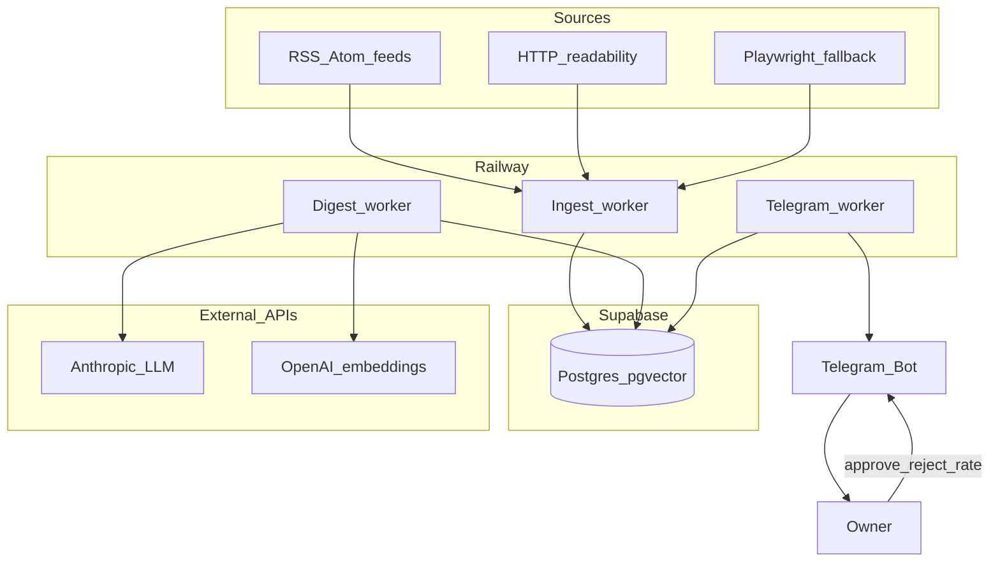
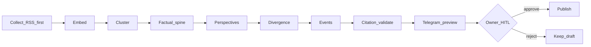

# newsie

Private, single-user **Berlin & Germany political news digest** agent.

**Topology:** Railway workers ↔ Supabase Postgres (+ pgvector) ↔ Telegram HITL  
**This repo ships an offline demo** (fixture sources + hash embeddings + stub LLM) so you can run the full spine without API keys.

## Architecture



## Digest pipeline



## Quick start — run the demo

```bash
cd newsie
curl -LsSf https://astral.sh/uv/install.sh | sh   # if needed
source ~/.local/bin/env

uv sync --group dev
uv run newsie demo
```

### Web UI

```bash
uv run newsie web --host 127.0.0.1 --port 8000
# open http://127.0.0.1:8000
# Run sample (fixtures) or Run live RSS (real Tagesschau/ZEIT/SPIEGEL/DW feeds)
```

### Live CLI fetch

```bash
uv run newsie live
```

### Persistence (Phase 2)

Default: SQLite `newsie_data.db` via `DATABASE_URL`.  
Supabase: set `DATABASE_URL` to your pooler URL and apply `migrations/001_init.sql` (enables `vector`).

Vercel: `vercel deploy` / claim temporary deploys. Entry: `api/index.py`.  
Note: anonymous `*.tmp.now` URLs often return **403 in browsers** — use local UI or claim the deployment.

What you should see:

1. A digest with factual spine, party perspectives, divergence, and events  
2. Citation validation status `ok`  
3. Auto-approve for demo (production waits on Telegram HITL)  
4. A source reliability update after a demo rating  

### Tests

```bash
uv run pytest -q
```

### Other commands

```bash
uv run newsie run          # alias for demo offline
uv run ruff check src tests
uv run mypy src
```

## Guardrails (efficient loops)

Aligned with [pstack](https://github.com/cursor/plugins/tree/main/pstack/skills) principles (`make-operations-idempotent`, `laziness-protocol`, `guard-the-context-window`):

| Guard | Behavior |
|-------|----------|
| `LoopGuard` | Hard caps on ingest/cluster iteration counts |
| `BudgetLedger` | Caps fetches, LLM tokens, pipeline steps; hard-stops |
| `KillSwitch` | Aborts pipeline between steps |
| Idempotent ingest | Same `content_hash` → no duplicate articles |
| Idempotent HITL approve | Re-approve returns existing publication |
| Bounded batches | `max_sources_per_run`, `max_articles_per_source`, `max_stories_per_digest` |
| Untrusted content | Fetched text is data only (never executed) |
| Citation validator | Blocks fabricated URLs before approve |

## Stack

| Layer | Choice |
|-------|--------|
| Language | Python 3.12 + uv |
| Validation | Pydantic / pydantic-settings |
| Demo embeddings | Deterministic hash vectors (1536-d) |
| Prod embeddings | OpenAI `text-embedding-3-small` (interface ready) |
| Prod LLM | Anthropic via `LLMProvider` (stub in demo) |
| Quality | ruff, mypy, pytest |

## Project layout

```
src/newsie/          # library + CLI
tests/               # unit/integration tests
data/                # seed source lists
ops/RESTORE.md       # Supabase restore notes
```

## Production notes

Set env vars (see `.env.example`): `DATABASE_URL`, `ANTHROPIC_API_KEY`, `OPENAI_API_KEY`, `TELEGRAM_BOT_TOKEN`, budget caps. Deploy workers on **Railway**; DB on **Supabase**. Dashboard and social collectors are out of MVP scope.
