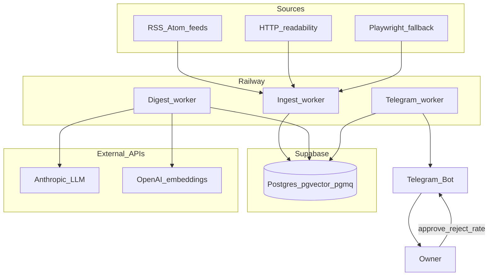
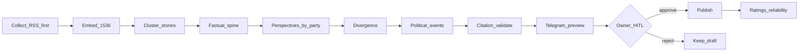

# VPS News App

Private, single-user **Berlin & Germany political news digest** — twice daily (`Europe/Berlin`), English output, HITL approval on Telegram.

**Topology:** Railway workers ↔ Supabase Postgres (+ pgvector) ↔ Telegram HITL

## Architecture

## Digest pipeline

## Docs

| Doc | Purpose |
|-----|---------|
| [project-context.md](./project-context.md) | Locked goals and decisions |
| [architecture-assessment.md](./architecture-assessment.md) | Critical review and rationale |
| [build-plan.md](./build-plan.md) | M0–M7 plan and acceptance |
| [build-spec.md](./build-spec.md) | Buildable product spec |

## Stack (locked)

- **Compute:** Railway (ingest / digest / Telegram workers)
- **DB:** Supabase Postgres + pgvector + DBOS
- **LLM:** Anthropic · **Embeddings:** OpenAI `text-embedding-3-small` (1536)
- **Collection:** RSS/HTTP first; Playwright fallback
- **Guardrails:** budgets, kill switch, citation validation, untrusted-content handling, HITL
